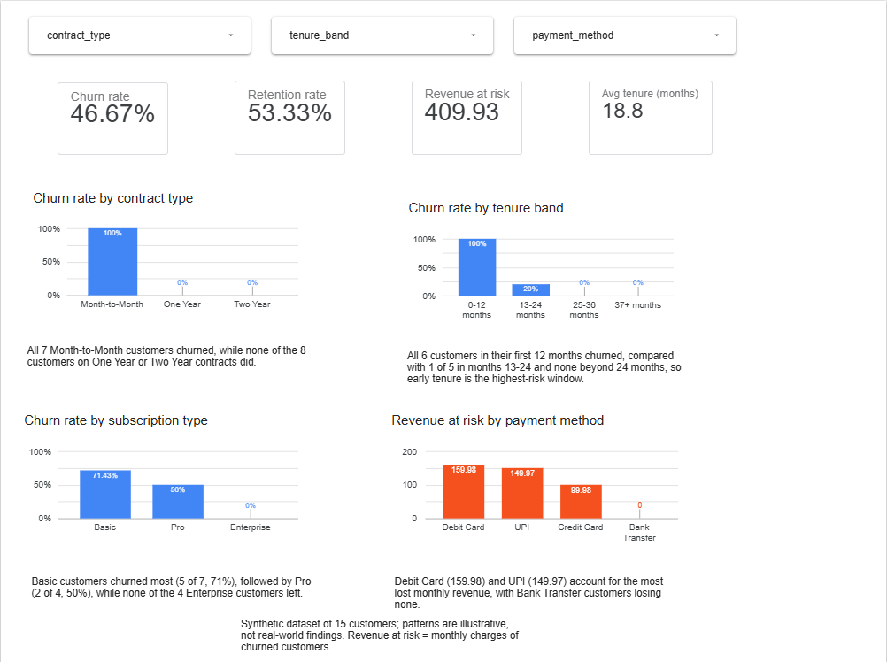

# Business KPI Dashboard: Customer Churn

**Live dashboard:** https://datastudio.google.com/reporting/5c85a017-046a-46c2-90c8-410973eb9a06

Interactive Looker Studio dashboard built on the cleaned **synthetic** customer churn dataset (15 customers) from my data-quality analysis. Findings are illustrative, not real-world insights.

## KPI definitions
| KPI | Definition | Value |
|---|---|---|
| Churn rate | Churned customers / all customers | 46.7% (7 of 15) |
| Retention rate | 1 - churn rate | 53.3% (8 of 15) |
| Revenue at risk | Monthly charges of churned customers (monthly recurring revenue lost) | 409.93 per month |
| Revenue at risk % | Revenue at risk / total monthly charges (1,269.85) | 32.3% |
| Average tenure | Mean months subscribed. Overall 18.8; churned 7.0; retained 29.1 | 18.8 months |

**Assumption:** the dataset has no "likely to churn" flag for active customers, so revenue at risk is measured as revenue already lost to churned customers. With real data, it would instead be the monthly revenue of active customers in high-risk segments.

## Filters
Three drop-down filters: contract type, tenure band (0-12, 13-24, 25-36, 37+ months) and payment method. They update every scorecard and chart. The written insights describe the full dataset and do not change with the filters.

## Insights (one per visual)
- **Churn by contract type:** all 7 Month-to-Month customers churned; none of the 8 on One Year or Two Year contracts did.
- **Churn by tenure band:** all 6 customers in their first 12 months churned, 1 of 5 in months 13-24, and none beyond 24 months. Early tenure is the high-risk window.
- **Revenue at risk by payment method:** Debit Card (159.98) and UPI (149.97) carry the most lost revenue. UPI churned 3 of 4 and Debit Card 2 of 2, but the group sizes are tiny.
- **Churn by subscription type:** Basic churned 5 of 7 (71%), Pro 2 of 4 (50%), Enterprise 0 of 4.

## Design notes
Blue bars show churn rates and orange bars show revenue, with titles and data labels on every chart. Tenure bands were created from `tenure_months` as a helper column.

## Limitations
Only 15 synthetic rows. Contract, tenure and plan are correlated (e.g. every Enterprise customer is on a Two Year contract), so these patterns are descriptive, not causal.

## Files
- `churn_dashboard_data.csv`: cleaned data plus helper columns (`tenure_band`, `churned`, `retained`, `revenue_at_risk`)
- `dashboard_screenshot.png`: screenshot of the dashboard with no filters applied
